# Cybersecurity Virtual Home Lab

## At a Glance

This project was completed to develop practical, hands-on experience administering enterprise Windows infrastructure and Linux servers within isolated virtual environments. 

### Project Summary

This repository documents two independent virtual lab environments built
in Oracle VirtualBox.

| Environment | Purpose | Core Technologies |
|------------|---------|-------------------|
| Enterprise Windows Lab | Windows enterprise administration | Windows Server 2022, Windows 11, Active Directory, DNS, DHCP |
| Linux Administration Lab | Linux administration & security testing | Ubuntu Server, Apache2, SSH, Kali Linux |

### Key Accomplishments

- Built two independent virtual lab environments using Oracle VirtualBox.
- Configured Windows Server 2022 as an Active Directory Domain Controller.
- Implemented DNS and DHCP services.
- Created Organizational Units, domain user accounts, and security groups.
- Installed and configured Apache2 on Ubuntu Server.
- Enabled secure remote administration using SSH.
- Performed network validation and basic enumeration from Kali Linux.
- Documented implementation steps and troubleshooting methodologies.

# Overview

This project documents the development of two independent virtual lab environments built using Oracle VirtualBox to strengthen practical skills in enterprise Windows administration and Linux system administration.

The first environment focuses on core Microsoft enterprise technologies by configuring a Windows Server 2022 Domain Controller and a Windows 11 domain client. Through this environment, I gained hands-on experience deploying Active Directory Domain Services (AD DS), configuring DNS and DHCP, creating and managing domain user accounts, creating Organizational Units (OUs), and implementing security groups. 

The second environment focuses on Linux administration and cybersecurity practices. An Ubuntu Server was configured to host an Apache2 web server, enable remote administration using SSH, and support network validation from a Kali Linux workstation. This environment provided experience in managing Linux services, troubleshooting connectivity issues, and performing basic network reconnaissance. 

Although the two environments were developed independently, together they strengthened my understanding of administering both Linux and Windows systems while reinforcing structured methodologies, enterprise networking concepts, and technical documentation.

# Lab Architecture

## Enterprise Windows Lab

### Purpose

Develop practical experience administering a Windows enterprise environment through AD-DS, DHCP, DNS, user management, and Windows networking. 

Virtual Machines:
- Windows Server 2022 (Domain Controller)
- Windows 11 (Domain Client)

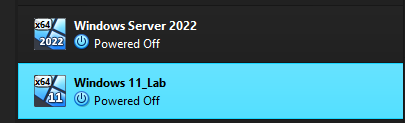

*Enterprise Windows lab consisting of a Windows Server 2022 Domain Controller and a Windows 11 domain client.*

## Linux Administration Lab

Purpose:

Develop Linux administration skills through server deployment, web server configuration, remote administration, and network validation. 

Virtual Machines:

- Ubuntu Server 
- Kali Linux 

Screenshot: 
(INSERT SCREENSHOT HERE)

# Objectives

## Enterprise Windows Lab

-   Deployed and configured Active Directory Domain Services (AD DS).
-   Configured DNS for internal name resolution.
-   Configured DHCP to automatically assign IP addresses to client systems.
-   Create Organizational Units (OUs) to organize domain resources.
-   Create and manage domain user accounts.
-   Configure Security Groups for role-based administration.

## Linux Administration Lab

-   Deployed and configured an Ubuntu Server.
-   Installed and configured the Apache2 web server.
-   Configured OpenSSH for secure remote administration.
-   Verified network connectivity between Ubuntu Server and Kali Linux.
-   Performed basic network reconnaissance using Kali Linux. 

# Technologies

## Virtualization

-   Oracle VirtualBox

## Windows

-   Windows Server 2022
-   Windows 11
-   Active Directory Domain Services (AD DS)
-   DNS
-   DHCP

## Linux

-   Ubuntu Server
-   Apache2
-   OpenSSH
-   UFW

## Security

-   Kali Linux
-   Nmap

# Enterprise Windows Lab

> **Goal:** Build and administer a Windows enterprise environment using Microsoft's core infrastructure services.

## Environment Overview

The Enterprise Windows Lab was designed to simulate a small business environment using Windows Server 2022 and Windows 11. The primary objective of this virtual environment was to gain practical experience administering a Windows domain and becoming familiar with core Microsoft enterprise technologies.

Through this lab, I configured Active Directory Domain Services (AD DS), DHCP, DNS, Organizational Units (OUs), domain user accounts, and security groups before validating communication between the Domain Controller and the Windows 11 client. 

This environment provided hands-on experience with centralized authentication, user administration, and network services commonly found in enterprise Windows environments. 
## Domain Controller

The first step in building the Windows environment was promoting the Windows Server to a Domain Controller and installing Active Directory Domain Services (AD DS).

A Domain Controller provides centralized authentication and authorization services for devices and users within a Windows domain. By configuring the server as the Domain Controller, it became responsible for managing user authentication, domain resources, and administrative policies through the environment.

### Tasks Completed 

- Installed Active Directory Domain Services (AD DS)
- Promoted Windows Server to a Domain Controller 
- Created a new Active Directory domain
- Verified successful domain deployment 

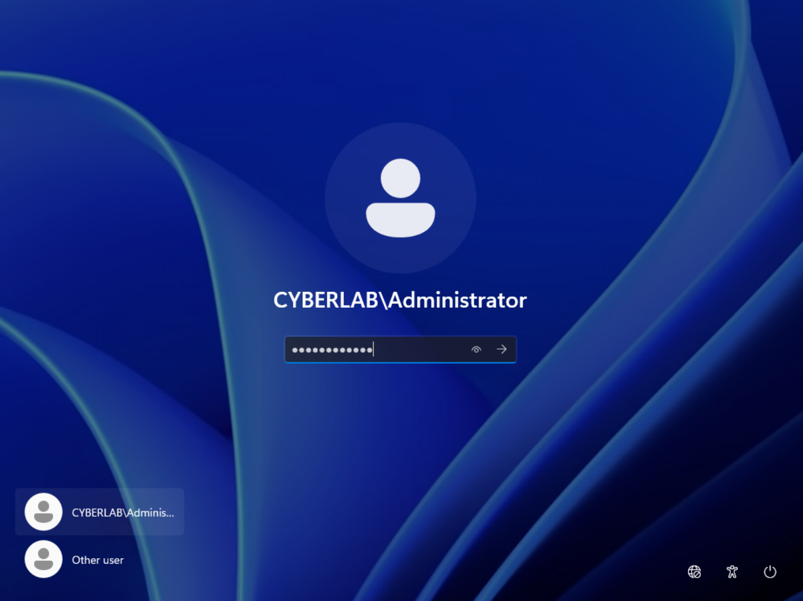

*Successfully authenticated to the Domain Controller using the built-in domain administrator account.*

## Organizational Units

To simulate a small enterprise environment, Organizational Units (OUs) were created to logically organize users by department. 

Organizational Units simplify administration by allowing users, computers, and other directory objects to be grouped according to their role within an organization. This structure also provides the foundation for applying Group Policy Objects (GPOs) and delegating administrative responsibilities as the environment grows.

### Organizational Units Created:

- Information Technology (IT)
- Finance 
- Human Resources 
- Executive

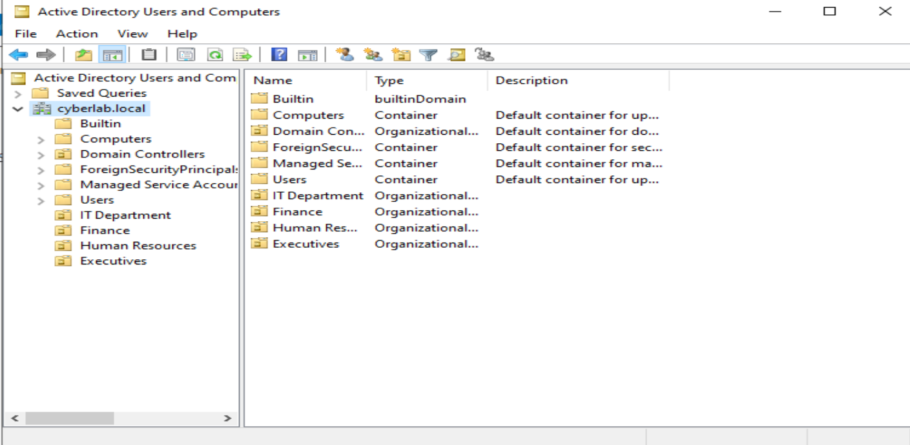

*Organizational Units created to separate users by department.*

 ## Domain User Accounts 

 After creating the Organizational Units (OUs), user accounts were created for each department to simulate employees within a small enterprise environment. Creating multiple departmental accounts provided practical experience with user management, account organization, and Active Directory administration. 

### Information Technology

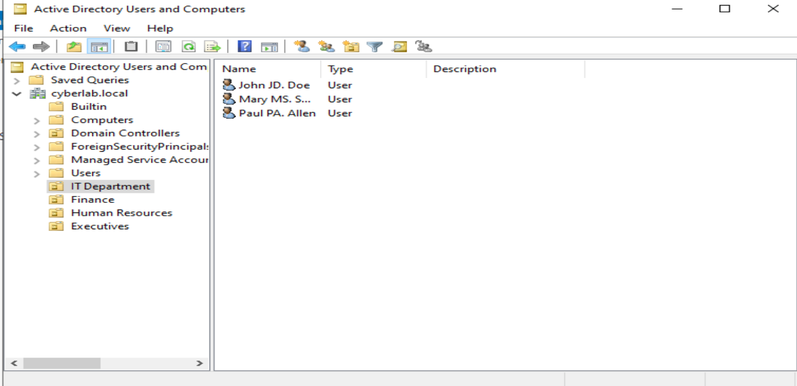

*Example user accounts created for the Information Technology department.*

### Finance

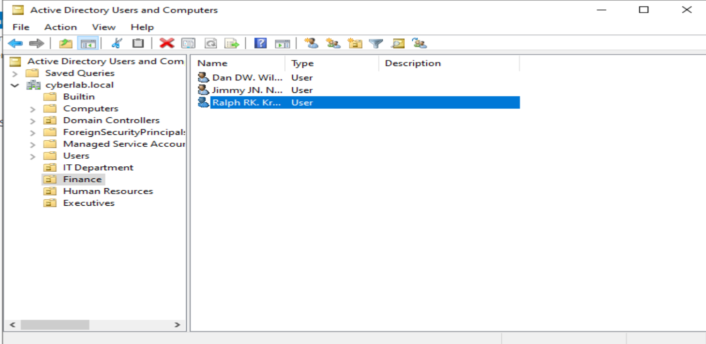

*Finance department user accounts.*

### Human Resources

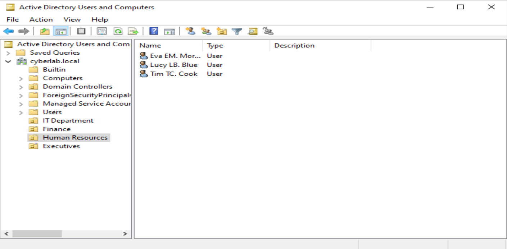

*Human Resources department user accounts.*

### Executive

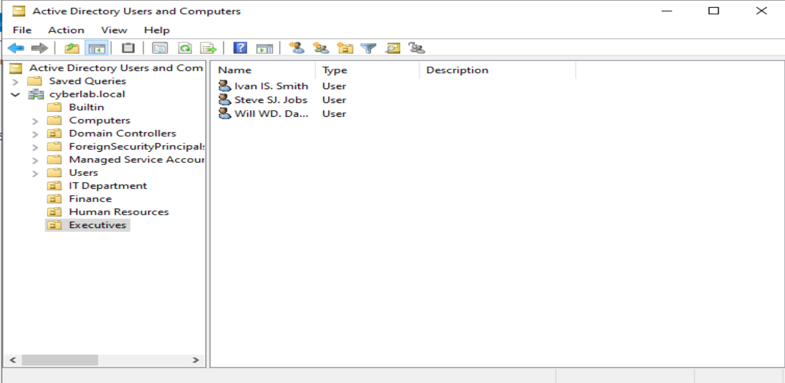

*Executive department user accounts.*

## Security Groups

Security Groups were created to demonstrate role-based administration within Active Directory.Rather than assigning permissions directly to individual users, Security Groups allowed for permissions to be managed centrally by grouping users according to their responsibilities. This approach follows enterprise best practices by simplifying administration and improving scalability. 

### Tasks Completed:

- Created role-based security groups 
- Added users to the appropriate groups 
- Verified group memberships

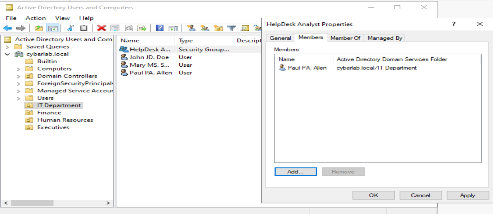

*Example Active Directory security group demonstrating centralized user management.*

## DNS

Active Directory depends heavily on DNS to locate domain resources and authenticate users. As part of this lab, DNS was configured to provide reliable name resolution throughout the Windows environment.

### Tasks Completed:

- Verified Forward Lookup Zones
- Verified Reverse Lookup Zones
- Validated DNS name resolution

**Note**: Future updates to this projects will include the screenshots of DNS configuration. 

## DHCP

DHCP was configured to automatically assign IP addresses and network configuration information to client systems within the virtual environment. Automating IP address assignment simplifies network administration while ensuring devices receive consistent network settings.   

### Tasks Completed:

- Created a DHCP scope 
- Configured the address pool 
- Verified client leases 
- Validated DHCP functionality

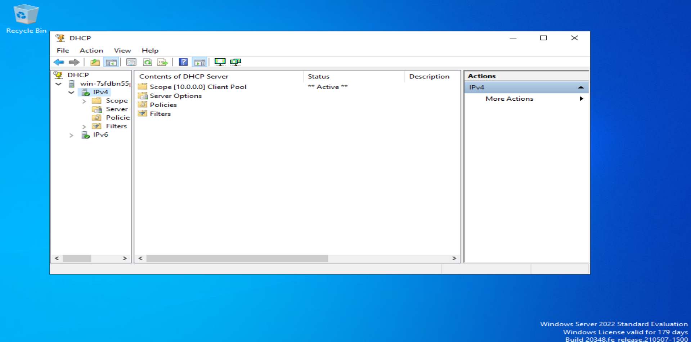

*Configured DHCP Scope.*

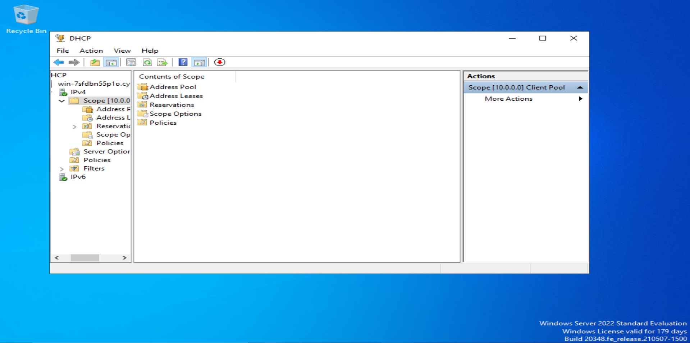

*DHCP scope configuration showing address leases and network options.*

## Windows Client Verification

After configuring Active Directory, DNS, and DHCP, the Windows 11 workstation was validated to ensure successful communication with the Domain Controller. The client successfully obtained network configuration information and communicated with the server, confirming that the core Windows infrastructure services were functioning correctly. 

### Validations Performed:

- Verified IP configuration 
- Confirmed DNS server assignment 
- Tested network connectivity
- Verified communication with the Domain Controller

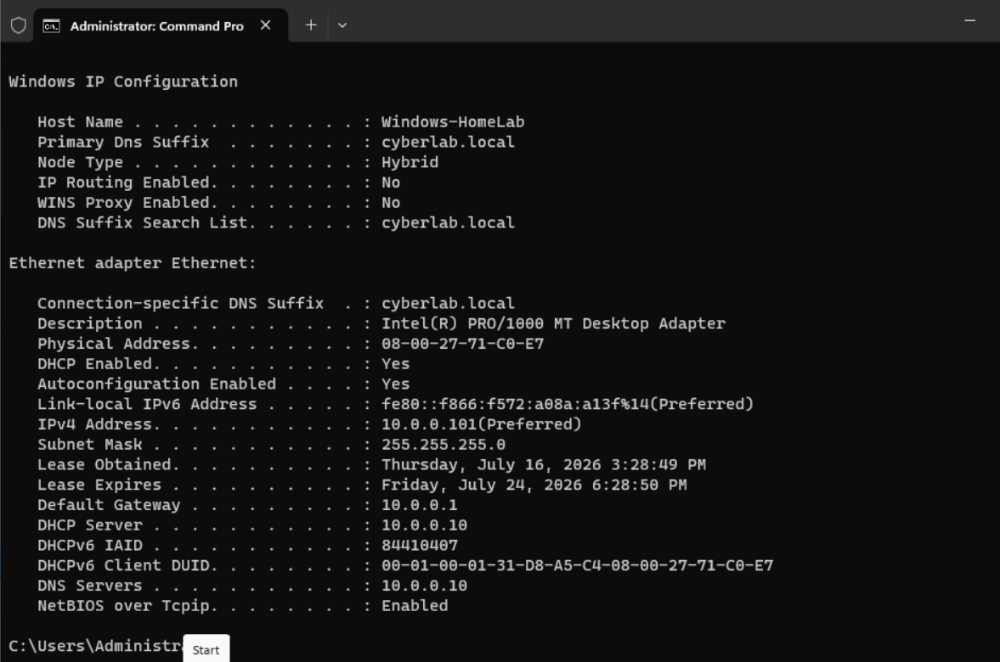

*Windows client network configuration.*

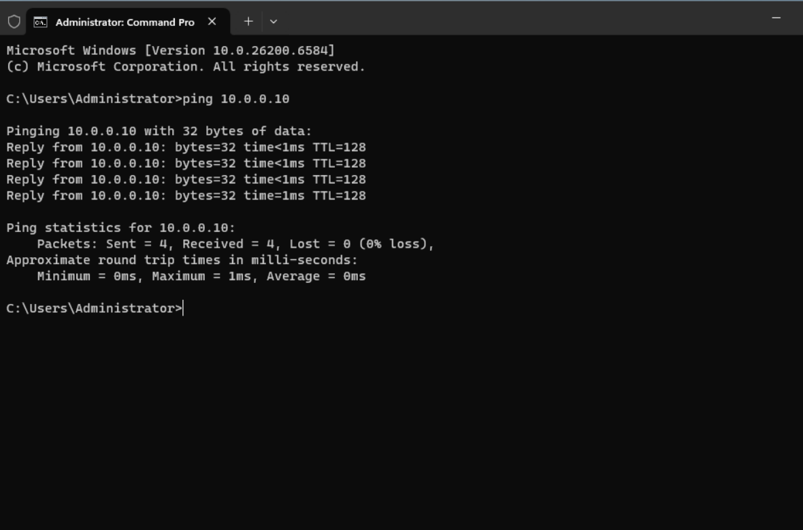

*Successful communication between the Windows client and the Domain Controller.*

# Linux Administration Lab

## Environment Overview

The Linux Administration Lab was developed independently from the Windows environment to strengthen practical Linux administration skills and gain hands-on experience managing common server services. This environment consisted of an Ubuntu Server that served as a primary web server and a Kali Linux workstation used for administration, connectivity testing, and basic network reconnaissance. 

Throughout this lab, I installed and configured Apache2, enabled SSH for remote administration, validated network connectivity, and used Kali Linux to interact with and assess the Ubuntu Server. This environment provided practical experience administering Linux systems while reinforcing networking fundamentals, service management, and troubleshooting methodologies commonly used by system administrators and cybersecurity professionals. 

## Ubuntu Server

Ubuntu Server served as the primary Linux server within the lab environment. The server was configured to host an Apache2 web server while also supporting secure remote administration through SSH. Throughout the project, Ubuntu was used to practice Linux system administration, service management, firewall configuration, and network troubleshooting.

### Tasks Completed:

- Installed Ubuntu Server
- Updated system packages
- Installed Apache2
- Configured the UFW firewall
- Enabled SSH
- Verified running services 

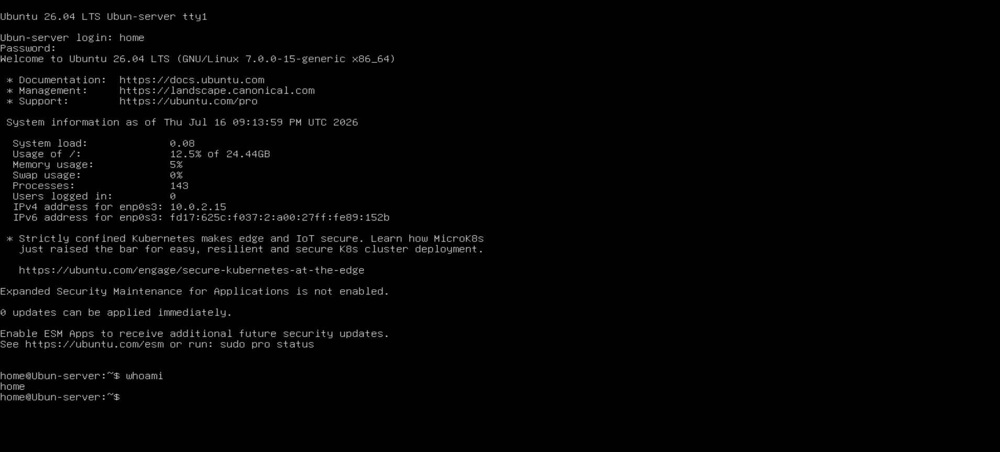

*Ubuntu Server configured for web hosting and remote administration.*

## Apache2 Web Server

Apache2 was installed to provide a simple web service that could be accessed from another virtual machine within the environment. Deploying a web server provided practical experience managing Linux services while creating a target for connectivity testing and network validation. 

### Tasks Completed:
- Installed Apache2
- Started the Apache service 
- Verified the service status
- Confirmed the default webpage loaded successfully 

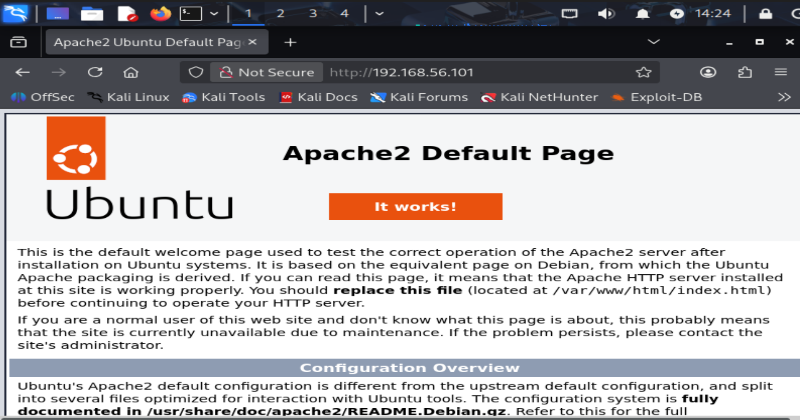

*Default Apache webpage successfully served from the Ubuntu Server.*

## Secure Shell (SSH) 

SSH was configured to allow secure remote administration of the Ubuntu Server from the Kali Linux workstation. Using SSH made it possible to administer the server remotely without requiring direct console access, closely mirroring how Linux servers are commonly managed in enterprise environments. 

### Tasks Completed:
- Enabled the SSH service
- Verified remote connectivity
- Successfully authenticated from Kali Linux 
- Performed remote administrative tasks 

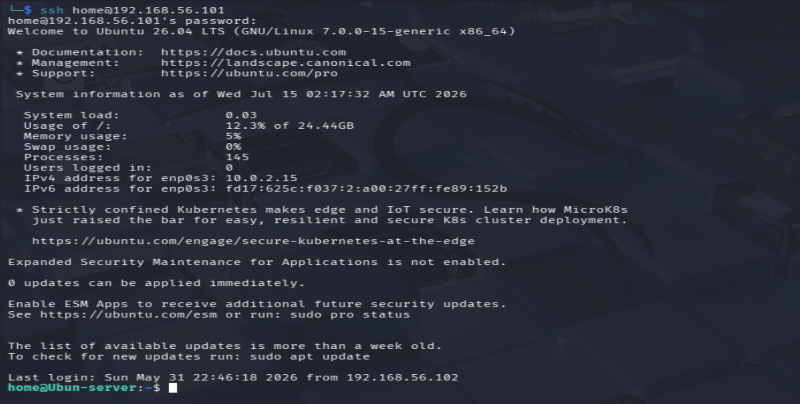

*Successful SSH connection established between Kali Linux and the Ubuntu Server.*

## Network Connectivity Verification

After configuring the Ubuntu Server, connectivity testing was performed in order to verify successful communication between the server and the Kali Linux workstation. The successful communication confirmed that the virtual machines were correctly configured and able to exchange network traffic.

### Validation Performed:

- Verified IP configuration 
- Tested connectivity using 'ping'
- Confirmed access to the Apache web server 
- Verified SSH connectivity

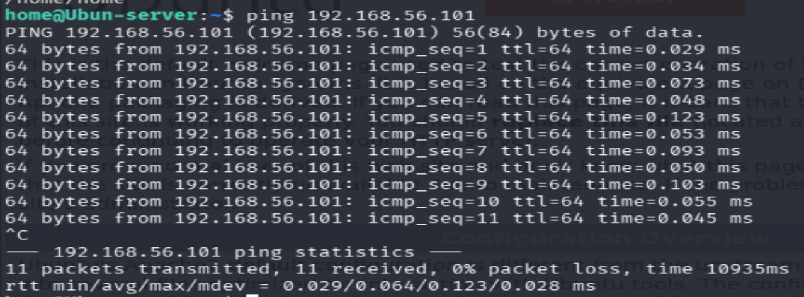

*Successful communication between Ubuntu Server and Kali Linux.*

## Kali Linux

Kali Linux served as the administrative and testing workstation throughout this environment. After the Ubuntu Server had been fully configured, Kali Linux was used to validate network connectivity, remotely administer the server using SSH, and perform basic network reconnaissance. Using Kali Linux in this lab reinforced fundamental networking concepts while providing practical experience interacting with Linux systems from a security-focused operating system. 

### Tasks Completed:

- Connected to Ubuntu Server using SSH 
- Validated network connectivity
- Performed network scanning 
- Verified running services 

# Troubleshooting & Validation 

Throughout both lab environments, I encountered configuration challenges while also performing validation tests to confirm that services were functioning properly. Rather than relying on the trial and error, I followed a troubleshooting methodology by verifying system configuration, testing network connectivity, validating running services, and isolating potential causes before properly implementing a solution. The following case studies summarizes a few examples of the process. 

## Case Study 1 - Apache Web Server Connectivity 

### Initial Issue

After installing Apache2 on the Ubuntu Server, I attempted to access the default webpage from the Kali Linux workstation. Although Apache2 had been installed successfully, the webpage could not be reached. 

### Investigation 

To  identify the root cause of this connectivity issue, I performed the following validation steps:

1. Confirmed Apache2 was correctly installed.
2. Verified that the Apache service was running using `systemctl status apache2` command.
3. Confirmed basic network connectivity between Ubuntu Server and Kali Linux using `ping` command.
4. Reviewed the Ubuntu firewall (UFW) configuration.
5. Verified that HTTP traffic on TCP port 80 was permitted.
6. Restarted the Apache service after updating the firewall configuration.
7. Restarted access from the Kali Linux workstation.

### Resolution 

After allowing the HTTP traffic through the Ubuntu firewall and confirming that the Apache service was active, the default Apache webpage became accessible from the Kali Linux workstation.

## Key Takeaway

This issue reinforced the importance of validating service status, firewall configuration, and network connectivity before assuming an application has been configured incorrectly. 

## Case Study 2 - SSH Remote Administration 

### Initial Issue

SSH connections from the Kali Linux workstation to the Ubuntu Server initially failed, preventing remote administration.

### Investigation

In order to isolate the issue, I performed the following steps:

1. Confirmed the OpenSSH service was installed. 
2. Verified that the SSH service was running.
3. Confirmed the Ubuntu Server IP address. 
4. Tested network connectivity using `ping` command.
5. Reviewed the UFW firewall configuration
6. Retested the SSH connection after confirming the required service and firewall settings.

### Resolution

Once the SSH service and firewall configuration were verified, remote administration was successfully established between the Ubuntu Server and Kali Linux workstation.

### Key Takeaway 

This issue demonstrates the importance of validating services and connectivity before unnecessarily modifying server configurations. 

## Case Study 3 - Windows Infrastructure Validation 

### Objective 

After successfully configuring Active Directory Domain Services, DNS, and DHCP, I needed to verify that the Windows 11 client could communicate successfully with the Domain Controller. 

### Validation Process

I performed the following steps for validation:

1. Verified the client's IP configuration.
2. Confirmed the DNS server assignment.
3. Verified that the client received a valid DHCP lease. 
4. Tested communication with the Domain Controller using `ping`.
5. Confirmed successful domain communication.

### Outcome

The Windows client successfully communicated with the Domain Controller, demonstrating that Active Directory, DNS, and DHCP had been configured correctly. 

### Key Takeaway

This validation process highlighted how closely Active Directory can depend on proper DNS configuration and reinforced the importance of testing enterprise infrastructure after deployment. 

------------------------------------------------------------------------

# Skills Demonstrated

## Enterprise Administration

- Active Directory Domain Services (AD DS)
- Domain Controller Administration 
- Organizational Units (OUs)
- Domain User Administration 
- Security Groups
- DNS
- DHCP

## Linux Administration

- Ubuntu Server Administration 
- Apache2 Web Server 
- OpenSSH
- UFW Firewall
- Service Management 

## Networking

- TCP/IP
- IP Addressing 
- DNS Resolution 
- Network Connectivity Validation 
- Network Troubleshooting 

## Cybersecurity

- Kali Linux
- Network Reconnaissance
- SSH Remote Administration 
- Security Documentation 

# Future Improvements

## Windows

- Deploy additional Windows clients to simulate a larger enterprise environment. 
- Implement Group Policy Objectives (GPOs) to enforce centralized security policies.
- Explore Active Directory delegation and advanced administrative roles.
- Configure Windows Server Update Services (WSUS) for centralized update management.

## Linux

- Deploy the Wazuh SIEM platform for centralized log monitoring.
- Perform vulnerability assessments using OpenVAS.
- Configure centralized logging for Linux services.
- Harden Apache2 using security best practices. 

# Lessons Learned

## Technical Lessons

Throughout the Windows Lab, I was able to strengthen my understanding of how Active Directory, DNS, and DHCP work together to provide centralized identity management and network services. The Linux Lab strengthened my understanding of Linux Server administration, Apache2, OpenSSH, and enterprise service management. 

## Professional Lessons

This project reinforced the importance of following a structured troubleshooting methodology rather than relying on the trial and error method to make configuration changes. Throughout both environments, I learned the importance of verifying services, confirming network connectivity, validating system configuration, and isolating any potential causes before taking action. Developing clear documentation throughout this project has also demonstrated the importance of being able to communicate technical work in a professional and structured manner. 
 

# References

-   **Microsoft Learn: Active Directory**
 https://learn.microsoft.com/en-us/windows-server/identity/ad-ds/get-started/virtual-dc/active-directory-domain-services-overview
-   **Microsoft Learn: DNS** 
https://learn.microsoft.com/en-us/windows-server/networking/dns/dns-overview
-   **Microsoft Learn: DHCP**
https://learn.microsoft.com/en-us/windows-server/networking/technologies/dhcp/dhcp-top
-   **Ubuntu Documentation** 
https://ubuntu.com/server/docs/
-   **Apache HTTP Server Documentation**
https://httpd.apache.org/docs/
-   **Oracle VirtualBox Documentation**
https://www.virtualbox.org/wiki/Documentation

