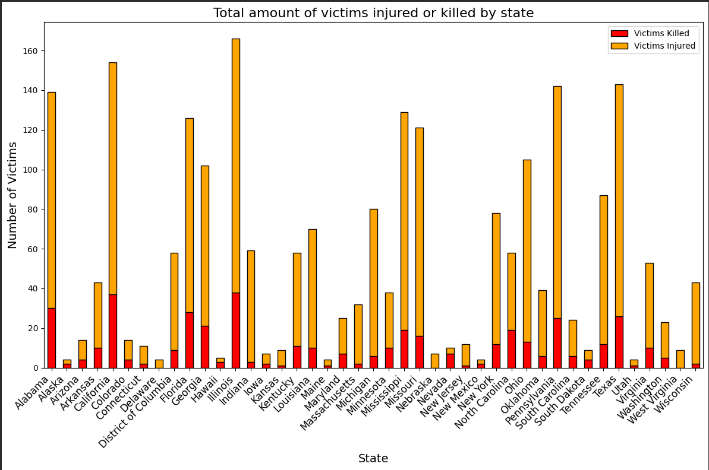
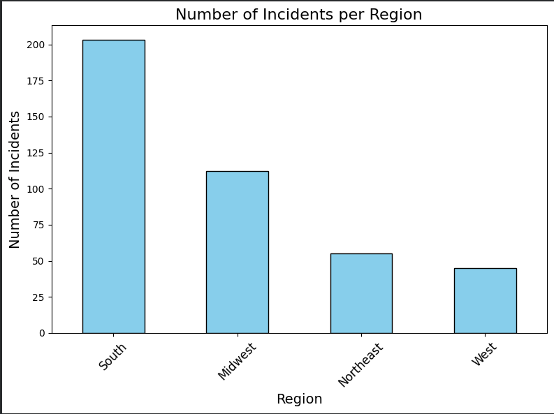
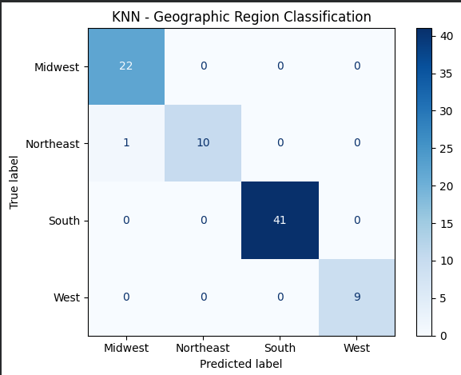
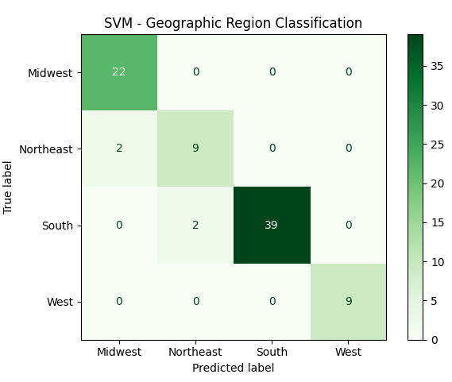

# Gun Violence Data Analysis Using Machine Learning 
**Authors:** Nicolas Angulo and Andres Martinez

## 1. Project Overview 

Gun violence remains a significant issue across the United States, affecting communities socially and economically. Understanding how these incidents vary across different states and geographic regions can provide valuable insight into patterns within recorded gun violence data. 

The purpose of this project was to explore how data analysis and machine learning could be used to examine geographic patterns in gun violence incidents across the United States. Through data preprocessing, visualization, and supervised machine learning, we aimed to identify patterns within the dataset and evaluate how different classification algorithms perform when applied to incident records. The project was developed using Python in Google Colab and implements three machine learning algorithms: Decision Tree, K-Nearest Neighbors (KNN), and Support Vector Machine (SVM). 

### Technologies and Tools Used

| Technology | Purpose |
|---|---|
| Python | Programming and machine learning |
| Pandas | Data manipulation and preprocessing |
| NumPy | Numerical operations |
| Matplotlib | Data visualization |
| Scikit-learn | Model training and evaluation |
| Graphviz | Decision tree visualization |
| Google Colab | Development and execution environment |

## 2. Problem Statement 

Gun violence is a complex issue influenced by various social, economic, and geographic factors. While incident records provide information about when and where gun violence occurs, analyzing these records can help identify differences in incident distributions and victim outcomes across geographic areas. 

The primary problem we wanted to explore was how machine learning and data mining techniques could be used to analyze gun violence incident records and identify geographic patterns. More specifically, we wanted to investigate:

- How recorded gun violence incidents and victim totals vary across different U.S. states and geographic regions.
- Whether geographic coordinates contain useful information for classifying fatal and nonfatal incidents.
- How accurately supervised machine learning algorithms can classify geographic regions based on incident locations.
- How different classification algorithms perform when applied to the dataset.

By addressing these questions, we aimed to better understand the capabilities and limitations of machine learning when working with geographic incident data. 

## 3. Project Objectives

The main objectives of this project were: 

- **Analyze geographic patterns** - Examine the distribution of gun violence incidents and victim totals across different states and regions.
- **Prepare the dataset** - Clean and preprocess incident records, address missing values, and select relevant features.
- **Apply machine learning algorithms** - Implement Decision Tree, KNN, and SVM classifiers.
- **Evaluate model performance** - Compare models using classification accuracy, precision, recall, F1-score, and confusion matrices.
- **Identify any limitations** - Determine whether the selected features provide meaningful predictive information and explore potential improvements.

## 4. Dataset Overview

The dataset was obtained from Kaggle's Gun Violence Data collection, with records attributed to the Gun Violence Archive.

**Dataset Source:** [Gun Violence Data — Kaggle](https://www.kaggle.com/datasets/whisperingkahuna/gunviolence1/data)

The dataset contains 427 recorded gun violence incidents across the United States, covering records from 2024.

The original dataset consists of 14 columns containing information such as:

- Incident ID and incident date
- State, city/county, and address
- Number of victims injured or killed
- Number of suspects arrested, injured, or killed
- Geographic coordinates (latitude and longitude)
- Additional incident-related information

### Data Selection and Cleaning 

To prepare the dataset for analysis, we examined the available features and identified those most relevant to our objectives. The preprocessing process included:

- Examining the dataset for missing values.
- Selecting relevant geographic and incident-related features.
- Mapping states into four geographic regions: Northeast, South, Midwest, and West.
- Calculating total recorded victims using the number of victims killed and injured.
- Creating a binary target for fatal versus nonfatal incident classification.
- Preparing separate training and testing datasets using an 80/20 split.
- Applying feature scaling to the KNN and SVM models through Scikit-learn pipelines.

These steps helped organize the dataset for analysis and machine learning.

## 5. Methodology 

The project followed a Knowledge Discovery in Databases (KDD) approach, using data selection, preprocessing, data mining, and evaluation to investigate patterns within the dataset.

### Part 1. Data Analysis

Before implementing the different machine learning algorithms, we examined the dataset to understand how recorded incidents and victim totals were distributed. 

Using Pandas and Matplotlib, we created visualizations showing:

- Victims killed and injured by state.
- Suspects killed and injured by state.
- Recorded gun violence incidents by geographic region.

These visualizations provided an overview of the geographic distribution of the dataset and helped identify differences in recorded incident counts and victim totals.

*Figure 1: Distribution of recorded victims across U.S. states.*

*Figure 2: Distribution of recorded incidents by geographic region.*

### Part 2. Decision Tree Classification

The Decision Tree classifier was implemented to explore whether geographic coordinates could be used to distinguish between fatal and nonfatal incidents.

For this classification task, incidents were assigned one of two categories:

- **Nonfatal (0)** - No recorded victim fatalities.
- **Fatal (1)** - At least one recorded victim fatality.

Latitude and longitude were selected as the model's input features.

The decision tree was configured with limits on tree depth and minimum leaf size to help reduce overfitting. The model was then evaluated using training and testing accuracy, precision, recall, F1-score, and a confusion matrix.

A majority-class baseline classifier was also introduced to determine whether the decision tree performed better than simply predicting the most common incident category. This experiment was designed to assess the predictive information available from geographic coordinates alone, rather than establish a reliable method for forecasting fatal incidents. 

  

  <em>Decision Tree Classification Model</em>

### Part 3. K-Nearest Neighbors (KNN)

KNN was implemented to classify recorded incidents into geographic regions using their latitude and longitude. The algorithm compares a new data point with nearby examples in the training dataset and assigns the most common class among its nearest neighbors. 

For this project, KNN was configured to use five nearest neighbors. Feature scaling was performed using StandardScaler within a Scikit-learn pipeline.

### Part 4. Support Vector Machine (SVM)

SVM was implemented as another geographic classification algorithm. The model uses a linear kernel to identify decision boundaries separating the geographic regions represented in the dataset. 

Like the KNN model, the SVM model uses latitude and longitude as input features and was trained using standardized data. The purpose of implementing both algorithms was to compare their classification performance on the same geographic dataset. 

  
  

  <em>KNN (left) and SVM (right) model evaluation.</em>

## 6. Model Evaluation and Results 

The machine learning models were evaluated using accuracy, precision, recall, F1-score, and confusion matrices.

### Decision Tree

The decision tree was evaluated on its ability to classify incidents as fatal or nonfatal using geographic coordinates. Its performance was also compared against a majority-class baseline to assess whether the model learned useful patterns beyond predicting the most common outcome. 

### KNN and SVM 

KNN and SVM were evaluated on their ability to classify geographic regions based on latitude and longitude. Both algorithms demonstrated strong geographic classification performance in the original experiments. However, because geographic regions are defined by location, high accuracy in these experiments was expected and should not be interpreted as evidence that the models can predict gun violence or identify high-risk locations. 

### Final Model Comparison

| Model | Classification Task | Testing Accuracy |
|---|---|---|
| Decision Tree | Fatal vs. Nonfatal | 55.81% |
| Majority-Class Baseline | Fatal vs. Nonfatal | 58.14% |
| KNN | Geographic Region | 98.80% |
| SVM | Geographic Region | 95.18% |

## 7. Challenges and Limitations 

Throughout this project, several challenges were identified:

**1. Dataset Size** - The dataset contains 427 recorded incidents, limiting the amount of information available for training and evaluating the models. 

**2. Feature Selection** - Identifying useful predictors was challenging as the dataset primarily contains geographic information and incident outcomes.

**3. Model Overfitting and Data Leakage** - The original decision tree experiment produced unusually high accuracy when predicting regional categories. The classification task was subsequently revised in order to reduce reliance on labels that were derived from the same data. 

**4. Geographic Classification** - KNN and SVM achieved high accuracy when classifying regions based on coordinates. However, these results primarily demonstrate geographic classification rather than the prediction of gun violence incidents. 

**5. Dataset Coverage** - The dataset represents a specific collection of recorded incidents and should not be interpreted as a complete representation of all gun violence in the United States. 

## 8. Future Improvements 

There are several improvements that can be made to expand the scope and reliability of the project:

- **Expand the dataset** - Incorporate additional years of incident records to improve geographic and temporal coverage.
- **Introduce additional features** - Explore socioeconomic indicators, demographic information, and other independently sourced contextual variables.
- **Improve model validation** - Implement cross-validation and parameter tuning to assess model stability.
- **Explore additional algorithms** - Compare other classification approaches using appropriate evaluation methods.
- **Improve geographic analysis** - Consider population-adjusted incident rates rather than relying solely on raw incident counts.

## 9. Conclusion

This project provided an opportunity to apply data mining and supervised machine learning techniques to a real-world dataset involving gun violence incidents in the United States. Through exploratory data analysis, we examined differences in recorded incidents and victim totals across states and regions. We then implemented Decision Tree, KNN, and SVM classifiers to investigate two classification tasks: incident fatality classification and geographic region classification. 

These results highlighted both the capabilities and limitations of machine learning. While KNN and SVM demonstrated strong performance in classifying geographic regions, the decision tree experiment emphasized the importance of meaningful feature selection, baseline comparisons, and careful model evaluation. 

Overall, this project strengthened our understanding of Python-based data analysis, preprocessing, supervised learning, model evaluation, and the interpretation of machine learning results. 
